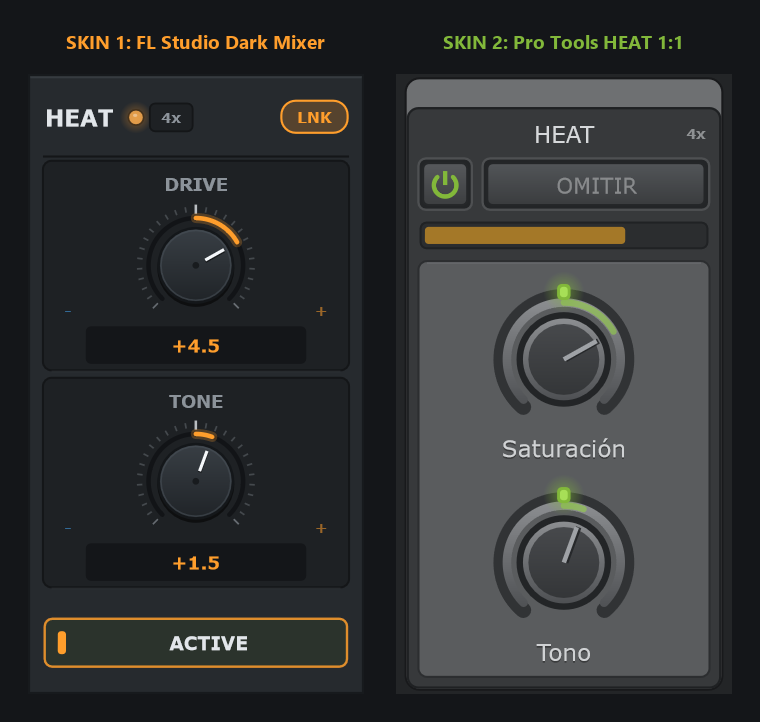
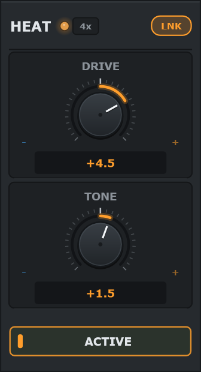
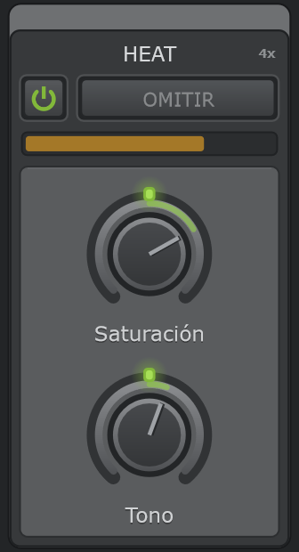
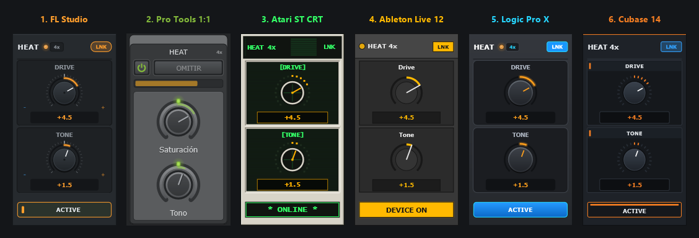

# 🔥 FL Heat - PAPIELGUAPO

**Clon 1:1 Bit-Exact del algoritmo Dave Hill / Crane Song Ocelot (Pro Tools HEAT), portado a VST3 (64-bit) y Aplicación Standalone (.EXE) para Windows con enlace global de consola (`LNK`) y 6 skins vectoriales integradas por [papielguapo](https://github.com/papielguapo).**

---

## 🖼️ Vista de Skins: FL Studio & Pro Tools HEAT 1:1



| **Skin 1: FL Studio (Dark Mixer UI)** | **Skin 2: Pro Tools HEAT 1:1 (Original)** |
| :---: | :---: |
|  |  |
| Chasis oscuro estilo mezclador de FL Studio (`#262A2E`), anillo bipolar naranja/cian, LED armónico reactivo y lectura numérica directa. | Recreación 1:1 de la tira HEAT de Pro Tools con botón de enlace `[⏻]`, interruptor `OMITIR`, barra de actividad armónica y controles `Saturación` y `Tono`. |

---

## 🎨 Colección Completa de 6 Skins Incluidas

Haz **clic derecho** en cualquier parte del plugin para abrir el menú contextual y cambiar al instante entre las **6 skins** (la elección se guarda con tu proyecto/sesión):



1. **FL Studio (Dark Mixer UI):** Estética nativa del mezclador oscuro de FL Studio con acentos cálidos en naranja (armónicos pares / válvula-cinta) y cian (armónicos impares / consola-transistor).
2. **Pro Tools HEAT 1:1 (Original):** Tira original de Pro Tools con botón `[⏻]`, `OMITIR` iluminado en ámbar, medidor horizontal y perillas con LED central verde.
3. **Atari ST / Retro PC (GEM CRT):** Interfaz retro biselada en beige TOS GEM con pantallas CRT de fósforo verde/ámbar y líneas de escaneo.
4. **Ableton Live 12 (Rack Device):** Diseño vectorial plano en gris carbón con bordes nítidos de 1 px y arcos macro amarillo/cian.
5. **Apple Logic Pro X (Space Grey):** Aluminio anodizado gris espacial, tarjetas oscuras y anillos de neón cian/naranja.
6. **Steinberg Cubase 14 (MixConsole):** Chasis pizarra profundo estilo MixConsole con bahías e indicadores LED naranja/azul.

---

## 🧠 Motor DSP 1:1 Bit-Exact (`Ocelot` / `HEAT.aaxplugin`)

El motor de audio (`Source/HeatDSP.h` y `Source/OcelotLUT.h`) replica exactamente el algoritmo original de **Dave Hill / Crane Song (`HEAT.aaxplugin` / `Ocelot.pdb`)**:

- **Generador de paquetes de coeficientes de 48 bytes (`0x500003290` — `OcelotCoefPacket`):** Síntesis polinómica y filtro de pre-énfasis/post-énfasis dependiente del control `Tone` y de la frecuencia de muestreo.
- **Motor DSP por canal (`0x500001B70` — `AlgEntry`):** Diferenciador de pre-énfasis, doble interpolación en cascada con realimentación armónica, filtro de estado post-énfasis de 1 polo, bloqueo DC a 7 Hz y compensación automática de ganancia.
- **Tabla Dual Waveshaper LUT de 32,768 floats (`0x5000194B0` — `kOcelotWaveshaperLUT`):**
  - **Banco 0 (`[0..16383]` — Drive Negativo `-10.0` a `0.0`):** Curva simétrica de estado sólido / consola (armónicos impares, pegada y transitorios definidos).
  - **Banco 1 (`[16384..32767]` — Drive Positivo `0.0` a `+10.0`):** Curva asimétrica de tríodo / cinta magnética (armónicos pares cálidos y densos).

---

## 🔗 Enlace Global de Consola (`LNK` / `IND`) y Oversampling

- **Consola Enlazada (`LNK` / Botón `[⏻]` en Pro Tools):**
  - **Activado por defecto (`LNK`):** Todas las instancias de **FL HEAT** insertadas en las pistas de tu mezclador comparten automáticamente los cambios de **Drive**, **Tone**, **Bypass** y **Oversampling** en tiempo real mediante memoria atómica compartida (`SharedHeatBus`), igual que el bus global HEAT en Pro Tools.
  - **Modo Individual (`IND`):** Desactiva el botón `LNK` en cualquier pista para ajustar esa instancia de forma totalmente independiente.
- **4 Modos de Oversampling (Click Derecho):**
  - **`1x` Native (0 muestras de latencia):** 100% bit-exact al procesamiento nativo de Pro Tools HEAT.
  - **`2x` Oversampling:** Sobremuestreo IIR polifásico de media banda de baja latencia.
  - **`4x` Oversampling (Por defecto):** Calidad de estudio de alta definición.
  - **`8x` Oversampling:** Modo Ultra Mastering.

---

## 🎚️ Controles y Atajos Rápidos

| Control | Rango | Valor por Defecto | Descripción y Atajos |
| :--- | :---: | :---: | :--- |
| **DRIVE (`Saturación`)** | `-10.0` a `+10.0` | `0.0` | `< 0`: Consola/Transistor (Impares) · `> 0`: Válvula/Cinta (Pares). **Doble clic** para reiniciar a `0.0`. |
| **TONE (`Tono`)** | `-10.0` a `+10.0` | `0.0` | `< 0`: Pre-énfasis cálido · `> 0`: Pre-énfasis brillante. **Doble clic** para reiniciar a `0.0`. |
| **LNK / IND (`[⏻]`)** | `LNK` / `IND` | `LNK` | Enlaza la instancia al bus maestro global o la deja independiente por pista. |
| **ACTIVE / BYPASS (`OMITIR`)** | `On` / `Bypass` | `Active` | Conmutación suave libre de clics (crossfade de 10 ms). |
| **Menú Contextual** | *Click Derecho* | — | Selector de **6 Skins**, **Oversampling (`1x`/`2x`/`4x`/`8x`)** y modo **`LNK`/`IND`**. |
| **Ajuste Fino** | `Ctrl` / `Shift` + Arrastrar | — | Sensibilidad de precisión y soporte para rueda del ratón. |

---

## 🚀 Instalación Rápida (Windows x64)

1. **Instalación automática con PowerShell:**
   Ejecuta `Install-FL-Heat.ps1` (como Administrador) para copiar el bundle `FL HEAT.vst3` a `C:\Program Files\Common Files\VST3\`.
2. **Instalación manual VST3:**
   Copia la carpeta **`FL HEAT.vst3`** (o desde `Binaries\FL HEAT.vst3`) dentro de:
   ```text
   C:\Program Files\Common Files\VST3\
   ```
3. **Versión Standalone (.EXE):**
   Ejecuta directamente **`Binaries\FL HEAT.exe`** sin necesidad de abrir un DAW.

---

## 🛠️ Compilación desde el Código Fuente (CMake + JUCE + Visual Studio)

```powershell
cmake -S . -B build -G "Visual Studio 18 2026" -A x64
cmake --build build --config Release --target FLHeat_VST3 FLHeat_Standalone -j 6
```

---

## 👤 Créditos

- **Autor del Port VST3/Standalone, Enlace de Consola `LNK` y Diseño Multi-Skin:** **[papielguapo](https://github.com/papielguapo)**
- **Algoritmo DSP Original (`Ocelot` / `HEAT`):** Dave Hill / Crane Song Ltd.
